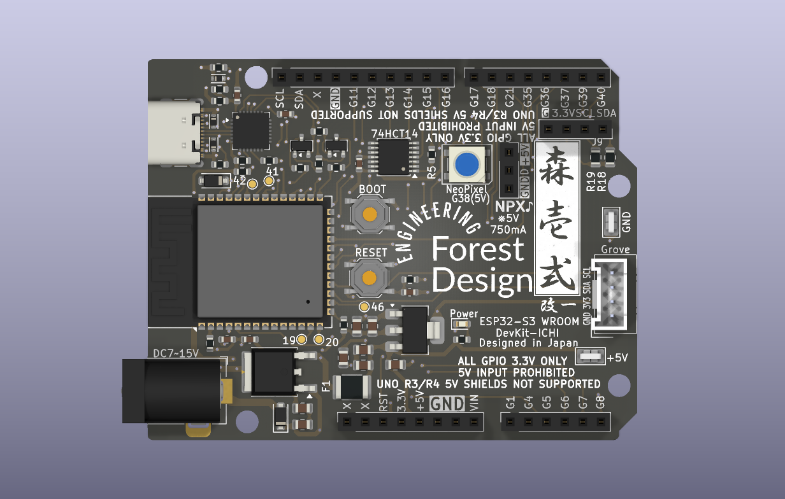
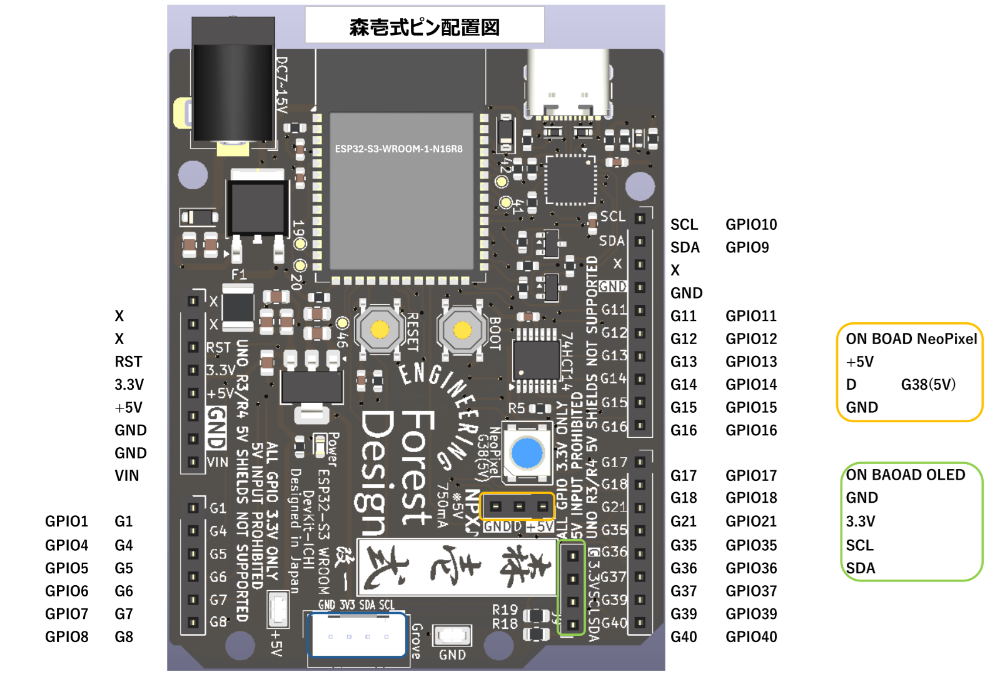
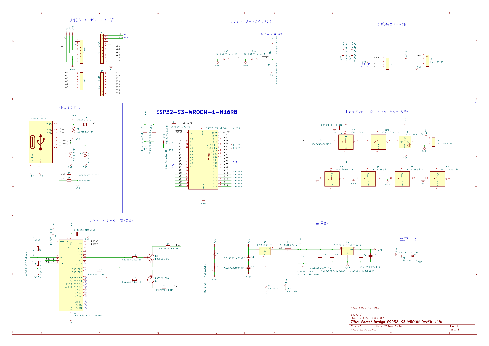

# 概要
Arduino UNOの外形で、マイコンにESP32-S3 WROOM-1 を実装したボードコンピューター
GPIOは全て+3.3V
Lチカ用にNeoPixelを搭載。 
NeoPixelは5Vを供給。パルスも5Vレベルに変換。更にNeoPixel信号を外部に出せる構成となっている。
更に、オンボードでOLEDが搭載可能にするコネクタランドも用意した。

# 名称
「森壱式」とした。本家「Arduino UNO」がイタリア語であることから、本家にリスペクトする意味も込めて完全日本語として名付けた。

# 開発へのいきさつ
以前よりESP32-S3を業務等で使用しており、その便利さや処理速度等のパワーを知っていた。
本家より「Arduino UNO R4」が発表となり、それで使用されるMCUがArmコア、そして通信用にESP32-S3が採用されているのを知った。
この時、ESP32-S3だけでも十分過ぎるを使えるんじゃね？と感想を抱いたのが開発のきっかけである。

# 特徴
Lチカをより楽しむために、NeoPixelへのドライブ能力を強化している。またオンボード上にNeoPixelを1個増設している。
ESP32-S3 WROOM-1 は 3.3V仕様であるが、NeoPixelのデータ信号で使用する「G38」を+5Vにレベル変換しオンボードのNeoPixelを駆動するほか、NPXコネクタにも5Vで出力している。さらに、5V電源も750mAまで出力可能な仕様としている。
その他、市販のOLEDを直接実装可能なコネクタスペース、Groveコネクタ実装可能なコネクタスペースを設けている。
GPIOはNeoPixel専用出力を除き、全て3.3Vである。

# 外観
部品面（イメージは改一のもの）

ハンダ面（イメージは改一のもの）

# 搭載マイコンモジュール
ESP32-S3-WROOM-1-N16R8 を搭載。
開発環境はESP32-S3 WROOM-1を参照のこと。
Arduino IDEで開発可能。

# 外部インターフェイス
- Grove互換 I2Cコネクタ装備。 使用電圧は+3.3V。
- NeoPixel用出力コネクタ搭載。5V MAX750mAまで本ボードのみで駆動できます。
# pin配置図

# 回路図

MORI_ICHI_1_SCH.pdf

